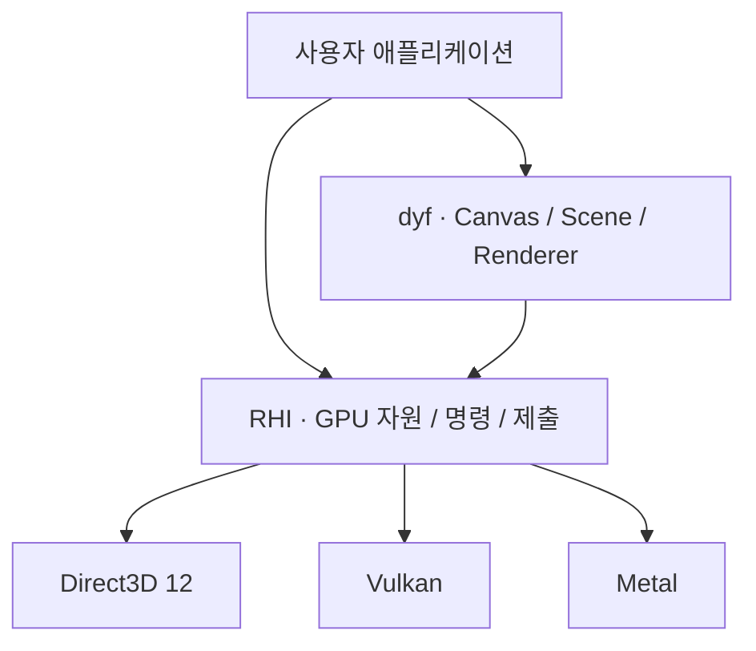

<h1 align="center">dy_engine</h1>

<p align="center"><strong>장면 구성부터 명시적 GPU 제어까지.</strong></p>

<p align="center">
Canvas · Scene · Renderer와 저수준 RHI를 제공하는 C++17 그래픽스 프레임워크<br>
Direct3D 12 · Vulkan · Metal
</p>

<p align="center">졸업작품 프로젝트 · [학교명] [학과명] · [제작 연도]</p>

<p align="center">
  <a href="#빠른-시작">빠른 시작</a> ·
  <a href="#예제-둘러보기">예제</a> ·
  <a href="https://dyd-dev.github.io/dy_engine/index.html">문서</a> ·
  <a href="https://dyd-dev.github.io/dy_engine/component/api-index.html">API 레퍼런스</a>
</p>

---

## 왜 dy_engine인가?

도형과 장면을 구성하는 API부터 GPU 자원과 명령 실행을 직접 다루는 API까지, 프로젝트에 필요한 수준에서 시작할 수 있습니다. 렌더링 기법을 실험하거나 자체 애플리케이션의 그래픽스 기반을 만드는 개발자를 위한 프레임워크입니다.

| 장면을 구성하는 API | GPU 실행을 직접 다루는 RHI | 필요한 기능을 선택하는 확장 |
| --- | --- | --- |
| `Canvas`로 2D 도형을 그리고, `Scene`과 `Renderer`로 메시·재질·조명을 구성합니다. | 버퍼·텍스처·파이프라인을 구성하고 자원 상태 전이, 명령 기록과 제출을 제어합니다. | Model·AdvancedRendering·ImGui와 프로파일링 도구를 목적에 맞게 연결합니다. |

**데이터 지향 설계와 명시적 GPU 제어.** Scene은 메시·재질·객체 변환을 분리된 배열로 관리합니다. RHI는 GPU 자원의 상태 전이와 명령 제출을 드러냅니다. 데이터 배치와 GPU 실행을 각각 살펴보고 설계할 수 있습니다.

## 빠른 시작

**Windows · Direct3D 12에서 첫 도형을 띄웁니다.** 외부 모델이나 HDR 자산 없이 시작하는 예제입니다.

준비물은 Git, CMake 3.20 이상, Visual Studio 2022 C++ 빌드 도구와 Windows SDK, 호스트에서 실행 가능한 `dxc`입니다. `dxc`를 PATH에 두거나 CMake에 `-DDY_DXC=실행_파일_경로`를 전달합니다. 첫 구성에는 외부 의존성을 다운로드할 네트워크 연결이 필요합니다.

```powershell
git clone https://github.com/dyd-dev/dy_engine.git
cd dy_engine
cmake -S . -B build/d3d12 -G "Visual Studio 17 2022" -A x64 -DUSE_D3D12=ON -DDY_BUILD_EXAMPLES=ON -DDY_ENABLE_TRACY=OFF
cmake --build build/d3d12 --config Release --target DyfPrimitives
.\build\d3d12\examples\dyf\01_Primitives\Release\DyfPrimitives.exe
```

실행하면 어두운 배경에 점·선·사각형·원이 표시됩니다. Windows에서 `USE_D3D12`와 `USE_VULKAN`을 모두 끄면 실제 픽셀을 렌더링하지 않는 Null 백엔드가 선택됩니다.

[다른 플랫폼의 준비물과 빌드 방법](https://dyd-dev.github.io/dy_engine/component/getting-started.html) · [직접 앱 작성하기](https://dyd-dev.github.io/dy_engine/component/quickstart.html)

### Canvas 코드 맛보기

창과 Renderer를 준비한 뒤 도형을 구성하는 부분입니다. 초기화·이벤트 루프·실패 처리를 포함한 전체 코드는 [Canvas 빠른 시작 예제](docs/component/examples/quickstart-canvas.cpp)에 있습니다.

```cpp
dyf::Canvas canvas(640, 480);
canvas.Clear({0.04f, 0.06f, 0.10f, 1.0f});
canvas.FillRect({80, 100, 220, 140}, {0.10f, 0.65f, 0.95f, 1.0f});
canvas.FillCircle({430, 230}, 70.0f, {1.0f, 0.65f, 0.15f, 1.0f});
canvas.Line({80, 340}, {540, 340}, {1, 1, 1, 1}, 3.0f);
```

GPU 프레임을 직접 구성하려면 [RHI 빠른 시작 예제](docs/component/examples/quickstart-rhi.cpp)에서 장치 생성 → 자원 상태 전이 → 명령 기록 → 제출 → 화면 표시 흐름을 확인할 수 있습니다.

## 예제 둘러보기

| 하고 싶은 일 | 시작할 예제 |
| --- | --- |
| 2D 도형 그리기 | [Primitives](examples/dyf/01_Primitives) |
| 메시와 재질 구성하기 | [Mesh & Material](examples/dyf/05_MeshMaterial) |
| 장면 구성하기 | [Scene](examples/dyf/08_Scene) |
| GPU 장치와 프레임 제출 이해하기 | [Device & Present](examples/RHI/01_DeviceAndPresent) |
| 컴퓨트 파이프라인 구성하기 | [Compute Pipeline](examples/RHI/08_ComputePipeline) |
| 여러 스레드에서 명령 기록하기 | [Parallel Recording](examples/RHI/10_ParallelRecording) |
| Render Graph로 패스 구성하기 | [Render Graph](examples/RHI/11_RenderGraph) |
| 고급 렌더링 기법 살펴보기 | [Advanced 예제 모음](examples/advanced) |

### 더 큰 장면으로 확장하기

| Showcase | 살펴볼 내용 |
| --- | --- |
| [Arena](showcase/arena) | 타일·모델 자산을 사용하는 장면 예제 |
| [Culling](showcase/culling) | GPU 컬링을 다루는 예제 |
| [Cinematic](showcase/cinematic) | 외부 환경 모델과 HDR 자산을 사용하는 장면 예제 |

고급 예제는 활성화한 확장과 GPU·백엔드 기능에 따라 사용 조건이 달라집니다. Showcase의 외부 모델·텍스처·HDR은 엔진 저장소에 모두 포함되어 있지 않습니다. [자산 준비와 경로 설정](https://dyd-dev.github.io/dy_engine/component/getting-started.html#assets)을 먼저 확인하세요.

## 구조

상위 API로 장면을 렌더링하거나 RHI를 직접 사용할 수 있습니다. 백엔드는 빌드할 때 선택합니다.



| 구성 | 역할 | 더 알아보기 |
| --- | --- | --- |
| dyf | 도형·장면·카메라·메시·재질·조명 구성 | [공개 API](src/Public/dyf) |
| RHI | GPU 자원·파이프라인·명령 목록·Render Graph | [RHI API](src/Public/dyf/RHI) |
| Model | 모델 로딩과 애니메이션 | [Model 문서](https://dyd-dev.github.io/dy_engine/component/model-extension.html) |
| AdvancedRendering | 선택적 고급 렌더링 기능 | [확장 API](src/Public/dyf/Extends/AdvancedRendering.h) |
| ImGui | 데스크톱 디버그 UI 구성 | [ImGui 예제](examples/dyf/10_ImGui) |
| Tracy · RenderDoc | 프로파일링 계측과 그래픽스 캡처 연동 | [빌드 옵션](#cmake-빌드-옵션) |

[모듈과 API 계층](https://dyd-dev.github.io/dy_engine/component/modules.html) · [RHI 프레임과 자원 수명](https://dyd-dev.github.io/dy_engine/component/rhi-lifecycle.html)

## 지원 플랫폼

| 플랫폼 | 그래픽스 백엔드 | 선택 방식 |
| --- | --- | --- |
| Windows | Direct3D 12 / Vulkan | `USE_D3D12` 또는 `USE_VULKAN` 중 하나 활성화 |
| Linux | Vulkan | 자동 선택, 창 시스템은 X11 / Wayland |
| macOS | Metal | 자동 선택 |
| Android | Vulkan | Android 앱 프로젝트 |
| iOS | Metal | iOS 앱 프로젝트 |

기능별 지원 여부는 백엔드와 장치에 따라 달라집니다. 데스크톱 ImGui 확장은 모바일에서 사용할 수 없으며, Metal 캡처에는 RenderDoc 대신 Xcode GPU Capture를 사용합니다.

## CMake 빌드 옵션

기본 엔진에 필요한 기능만 활성화합니다. 백엔드나 주요 옵션을 바꿀 때는 새 빌드 디렉터리를 사용하세요.

<details>
<summary>전체 옵션과 기본값 보기</summary>

| 옵션 | 엔진 기본값 | 설명 |
| --- | --- | --- |
| `USE_VULKAN` | `OFF` (Windows) | Windows에서 Vulkan 선택 |
| `USE_D3D12` | `OFF` (Windows) | Windows에서 Direct3D 12 선택 |
| `DY_BUILD_EXAMPLES` | `OFF` | 예제와 통합 실행기 빌드 |
| `DY_EXTEND_MODEL` | `OFF` | 모델 로딩·애니메이션 확장 |
| `DY_EXTEND_ADVANCED_RENDERING` | `OFF` | 고급 렌더링 확장 |
| `DY_EXTEND_IMGUI` | `OFF` | 데스크톱 ImGui 확장 |
| `DY_ENABLE_SIMD` | `ON` | SIMD 연산 |
| `DY_ENABLE_TRACY` | `ON` | Tracy 프로파일링 연결 |
| `DY_ENABLE_LIVE_PROFILING` | `OFF` | 실행 진단 수집 |
| `DY_ENABLE_RENDERDOC` | `OFF` | RenderDoc 연결 |
| `DY_LINUX_WINDOW_SYSTEM` | `AUTO` | Linux 창 시스템: `AUTO`·`X11`·`WAYLAND` |

</details>

Model과 AdvancedRendering을 모두 켜서 ShowcaseCinematic을 구성할 때는 외부 장면과 HDR 경로도 준비해야 합니다. [확장 연결·자산 설정·문제 해결](https://dyd-dev.github.io/dy_engine/component/getting-started.html)에서 상세 조건을 확인할 수 있습니다.

## CI

공통 examples 앱을 다음 구성으로 빌드합니다. **CI는 빌드 성공 여부를 확인하며, 실기기 실행이나 성능을 보증하는 표는 아닙니다.**

| 플랫폼 | 빌드 |
| --- | --- |
| Linux | Vulkan Debug/Release |
| Windows | Vulkan·Direct3D 12 Debug/Release |
| macOS | Metal Debug/Release |
| Android | Debug/Release APK, arm64-v8a·x86_64 |
| iOS | Debug/Release, 기기·시뮬레이터 arm64 대상, 코드 서명 제외 |

[CI 안내](.github/ci/README.md) · [원본 저장소의 빌드 결과](https://github.com/dyd-dev/dy_engine/actions/workflows/ci.yml)

## 문서

- [시작하기](https://dyd-dev.github.io/dy_engine/component/getting-started.html): 준비물, 플랫폼별 빌드, 외부 자산과 문제 해결
- [빠른 시작](https://dyd-dev.github.io/dy_engine/component/quickstart.html): Canvas와 RHI의 완전한 앱 예제
- [API 레퍼런스](https://dyd-dev.github.io/dy_engine/component/api-index.html): 공개 API 찾아보기
- [Renderer 입력 준비](https://dyd-dev.github.io/dy_engine/component/renderer-inputs.html): 셰이더와 외부 입력 조건
- [전체 문서](https://dyd-dev.github.io/dy_engine/index.html): 모듈별 설명과 사용 흐름

## 제작 배경

dy_engine은 **[학교명] [학과명]의 [제작 연도] 졸업작품 프로젝트**입니다.

장면 데이터를 구성하는 상위 API부터 GPU 자원과 명령 실행을 다루는 저수준 RHI까지 직접 설계하고 구현하며, 그래픽스 시스템의 구조와 실행 흐름을 탐구합니다. 데이터 지향 설계와 명시적 GPU 제어를 실제 프레임워크에 적용하고, 예제와 문서를 통해 설계와 사용 방법을 전달하는 것을 목표로 합니다.

## 개발팀

<!-- 실제 팀원 수에 맞춰 행을 추가하고, 이름·담당 영역·주요 기여·GitHub 주소를 채워주세요. -->

| 개발자 | 담당 영역 | 주요 기여 | GitHub |
| --- | --- | --- | --- |
| [이름 입력 예정] | [담당 영역 입력 예정] | [설계·구현·검증한 내용 입력 예정] | [GitHub 주소 입력 예정] |
