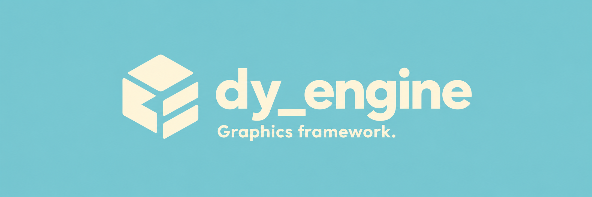
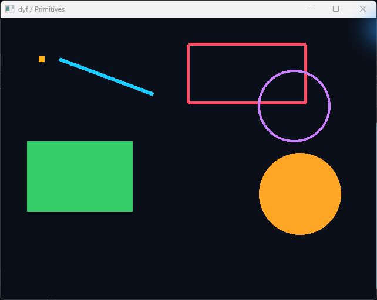
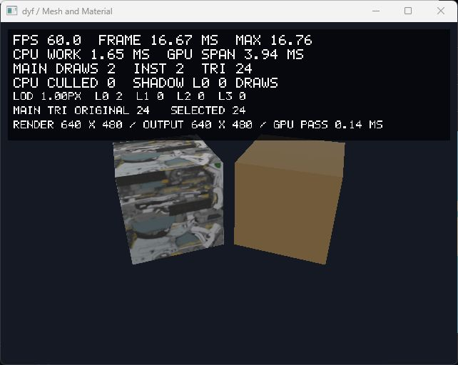
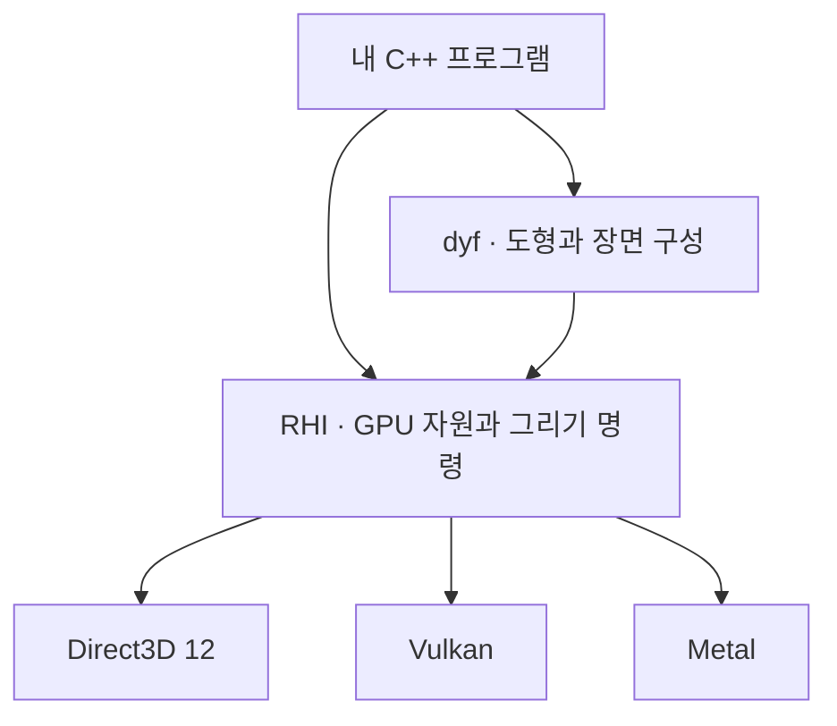

<p align="center">
  
</p>

<h1 align="center">dy_engine</h1>

<p align="center">
  <strong>C++로 2D 도형과 3D 장면을 그리는 그래픽스 프레임워크</strong><br>
  화면을 그리는 과정을 직접 만들고 이해하기 위해 시작한 졸업작품입니다.
</p>

<p align="center">
  <a href="#실행-화면">실행 화면 보기</a> ·
  <a href="#빠른-시작">직접 실행하기</a> ·
  <a href="https://dyd-dev.github.io/dy_engine/docs/index.html">공식 문서</a> ·
  <a href="#개발팀">개발팀</a>
</p>

<p align="center">동양미래대학교 컴퓨터소프트웨어공학과 · 2026 졸업작품 프로젝트</p>

---

## 실행 화면

dy_engine은 개발자가 C++ 프로그램에 연결해 쓰는 렌더링 라이브러리입니다. 아래 화면은 이 저장소의 예제를 직접 빌드하고 실행해 촬영했습니다.

| 2D 도형 그리기 | 3D 모델의 재질과 조명 표현하기 |
| --- | --- |
|  |  |
| 점·선·사각형·원을 코드로 배치합니다.<br>[Primitives 예제](examples/dyf/01_Primitives) | 같은 큐브에 서로 다른 표면 속성을 적용합니다.<br>[Mesh & Material 예제](examples/dyf/05_MeshMaterial) |

촬영 환경: Windows · Direct3D 12 · Release. 3D 화면 상단의 숫자는 엔진의 실행 진단 표시입니다.

## 제작 배경

**렌더링은 도형과 모델의 데이터를 화면에 보이는 이미지로 만드는 과정입니다.** 그 안에서는 데이터를 GPU로 보내고, 무엇을 어떤 순서로 그릴지 정하고, 작업이 끝날 때까지 자원을 관리해야 합니다.

우리는 이 과정을 직접 구현하면서 **서로 다른 그래픽스 API를 공통 구조로 다루는 방법**을 배우고자 했습니다. 공통 코어와 Direct3D 12·Vulkan·Metal 백엔드를 나누어 개발하고, 도형을 그리는 작은 예제부터 3D 장면까지 연결했습니다.

dy_engine은 **동양미래대학교 컴퓨터소프트웨어공학과의 2026 졸업작품 프로젝트**입니다. 결과 화면뿐 아니라, 그 화면이 만들어지는 코드와 설계도 함께 살펴볼 수 있도록 구성했습니다.

## 왜 dy_engine인가?

**작은 예제에서 시작할 수 있습니다.** 점과 선을 그린 다음 메시, 재질, 조명으로 넘어갑니다. 처음부터 큰 장면이나 외부 모델 파일을 준비할 필요가 없습니다.

**필요한 깊이까지 직접 다룰 수 있습니다.** 화면을 만들 때는 도형·장면 API를 사용하고, GPU 동작을 실험할 때는 자원과 그리기 명령을 직접 구성합니다. 이 저수준 공통 인터페이스를 **RHI(Rendering Hardware Interface)**라고 부릅니다.

**코드와 한국어 문서를 함께 읽을 수 있습니다.** 예제로 사용 흐름을 보고, [공식 문서](https://dyd-dev.github.io/dy_engine/docs/index.html)에서 각 API의 역할·사용 조건·자원 수명을 확인할 수 있습니다.

| 이런 작업을 하고 싶다면 | 여기서 시작하세요 |
| --- | --- |
| C++로 도형이나 간단한 3D 화면 만들기 | [dyf 예제](examples/dyf) |
| GPU에 작업을 보내는 과정 이해하기 | [RHI 예제](examples/RHI) |
| 조명·그림자·컬링 같은 기법 실험하기 | [Advanced 예제](examples/advanced) |

## 빠른 시작

**Windows에서 첫 도형 화면을 띄우는 방법입니다.** 위의 2D 예제를 실행하며, 외부 모델 자산은 필요하지 않습니다.

준비물:

- Git, CMake 3.20 이상, Visual Studio 2022의 C++ 빌드 도구와 Windows SDK
- GPU에서 실행할 프로그램을 컴파일하는 도구인 **`dxc`**. PATH에 추가하거나 CMake에 `-DDY_DXC=실행_파일_경로`를 전달합니다.

첫 구성에는 공개 의존성을 내려받을 네트워크 연결이 필요합니다. [개발 환경 준비](https://dyd-dev.github.io/dy_engine/docs/component/getting-started.html)에서 도구와 경로 설정을 확인할 수 있습니다.

```powershell
git clone https://github.com/dyd-dev/dy_engine.git
cd dy_engine

cmake -S . -B build/d3d12 `
  -G "Visual Studio 17 2022" -A x64 `
  -DUSE_D3D12=ON -DDY_BUILD_EXAMPLES=ON `
  -DDY_ENABLE_TRACY=OFF

cmake --build build/d3d12 --config Release --target DyfPrimitives
.\build\d3d12\examples\dyf\01_Primitives\Release\DyfPrimitives.exe
```

어두운 배경에 점·선·사각형·원이 보이면 첫 실행이 완료된 것입니다.

[다른 플랫폼에서 시작하기](https://dyd-dev.github.io/dy_engine/docs/component/getting-started.html#platforms) · [직접 앱 작성하기](https://dyd-dev.github.io/dy_engine/docs/component/quickstart.html)

<a id="canvas-코드-맛보기"></a>

<details>
<summary>도형을 그리는 코드는 어떻게 생겼나요?</summary>

창과 Renderer를 준비한 뒤, Canvas에 그릴 도형을 추가하는 부분입니다.

```cpp
dyf::Canvas canvas(640, 480);
canvas.Clear({0.04f, 0.06f, 0.10f, 1.0f});
canvas.FillRect({80, 100, 220, 140}, {0.10f, 0.65f, 0.95f, 1.0f});
canvas.FillCircle({430, 230}, 70.0f, {1.0f, 0.65f, 0.15f, 1.0f});
canvas.Line({80, 340}, {540, 340}, {1, 1, 1, 1}, 3.0f);
```

초기화·이벤트 루프·실패 처리를 포함한 [전체 Canvas 예제](docs/component/examples/quickstart-canvas.cpp)를 참고하세요. GPU 프레임을 직접 구성하는 [전체 RHI 예제](docs/component/examples/quickstart-rhi.cpp)도 있습니다.

</details>

## 예제 둘러보기

| 단계 | 확인할 수 있는 것 | 예제 |
| --- | --- | --- |
| 도형 | 점·선·사각형·원 그리기 | [Primitives](examples/dyf/01_Primitives) |
| 3D 장면 | 메시의 표면을 바꾸고 객체를 배치하기 | [Mesh & Material](examples/dyf/05_MeshMaterial) · [Scene](examples/dyf/08_Scene) |
| GPU 작업 | 장치를 만들고 작업을 제출하기 | [Device & Present](examples/RHI/01_DeviceAndPresent) |
| GPU 계산 | 그리기 외의 계산 작업 구성하기 | [Compute Pipeline](examples/RHI/08_ComputePipeline) |
| 병렬 기록 | 여러 스레드에서 그리기 명령 준비하기 | [Parallel Recording](examples/RHI/10_ParallelRecording) |
| 패스 구성 | 여러 렌더링 작업의 의존 관계 연결하기 | [Render Graph](examples/RHI/11_RenderGraph) |
| 고급 기법 | 조명·그림자·후처리·컬링 실험하기 | [Advanced](examples/advanced) |

<a id="더-큰-장면으로-확장하기"></a>

<details>
<summary>더 큰 장면: Arena · Culling · Cinematic</summary>

| Showcase | 살펴볼 내용 |
| --- | --- |
| [Arena](showcase/arena) | 타일·모델 자산을 사용하는 장면 예제 |
| [Culling](showcase/culling) | GPU 컬링을 다루는 예제 |
| [Cinematic](showcase/cinematic) | 외부 환경 모델과 HDR 자산을 사용하는 장면 예제 |

고급 예제는 확장 옵션과 GPU·백엔드 기능에 따라 사용 조건이 달라집니다. Showcase의 외부 모델·텍스처·HDR은 저장소에 모두 포함되어 있지 않으므로 [자산 준비와 경로 설정](https://dyd-dev.github.io/dy_engine/docs/component/getting-started.html#assets)을 확인하세요.

</details>

## 구조

**장면을 구성하는 코드 → 공통 GPU 인터페이스 → 각 그래픽스 API** 순서로 이어집니다. GPU 동작을 직접 실험할 때는 가운데의 RHI부터 사용할 수도 있습니다.



<details>
<summary>데이터 지향 설계·명시적 GPU 제어·확장 모듈 자세히 보기</summary>

- **데이터 지향 설계:** 작업할 데이터를 어떻게 배치하고 읽을지 고려하는 설계입니다. Scene은 메시·재질·객체 변환 등을 분리된 배열로 관리합니다.
- **명시적 GPU 제어:** GPU 자원을 언제 어떤 상태로 사용하고 명령을 언제 제출할지 직접 정하는 방식입니다. RHI에서 자원 상태 전이와 명령 기록·제출을 다룹니다.

| 구성 | 역할 | 더 알아보기 |
| --- | --- | --- |
| dyf | 도형·장면·카메라·메시·재질·조명 구성 | [공개 API](src/Public/dyf) |
| RHI | GPU 자원·파이프라인·명령 목록·Render Graph | [RHI API](src/Public/dyf/RHI) |
| Model | 모델 파일 읽기와 애니메이션 | [Model 문서](https://dyd-dev.github.io/dy_engine/docs/component/model-extension.html) |
| AdvancedRendering | 선택적 고급 렌더링 기능 | [확장 API](src/Public/dyf/Extends/AdvancedRendering.h) |
| ImGui | 데스크톱 디버그 UI 구성 | [ImGui 예제](examples/dyf/10_ImGui) |
| Tracy · RenderDoc | 실행 시간 측정과 그래픽스 캡처 도구 연동 | [빌드 옵션](#cmake-빌드-옵션) |

[모듈과 API 계층](https://dyd-dev.github.io/dy_engine/docs/component/modules.html) · [RHI 프레임과 자원 수명](https://dyd-dev.github.io/dy_engine/docs/component/rhi-lifecycle.html)

</details>

## 지원 플랫폼

백엔드는 공통 RHI를 실제 그래픽스 API에 연결하는 구현입니다. 아래는 저장소의 플랫폼별 구성입니다.

| 플랫폼 | 그래픽스 백엔드 | 선택 방식 |
| --- | --- | --- |
| Windows | Direct3D 12 / Vulkan | `USE_D3D12` 또는 `USE_VULKAN` 중 하나 활성화 |
| Linux | Vulkan | 자동 선택, 창 시스템은 X11 / Wayland |
| macOS | Metal | 자동 선택 |
| Android | Vulkan | Android 앱 프로젝트 |
| iOS | Metal | iOS 앱 프로젝트 |

기능별 지원 여부는 백엔드와 장치에 따라 달라집니다. Windows에서 두 백엔드 옵션을 모두 끄면 실제 화면을 그리지 않는 Null 백엔드가 선택됩니다. 데스크톱 ImGui 확장은 모바일에서 사용할 수 없으며, Metal 캡처에는 Xcode GPU Capture를 사용합니다.

## CMake 빌드 옵션

필요한 기능만 켜서 빌드할 수 있습니다. 처음에는 빠른 시작의 기본 옵션으로 실행하고, 다른 백엔드나 확장을 사용할 때 아래 표를 참고하세요.

<details>
<summary>전체 옵션과 기본값 보기</summary>

| 옵션 | 엔진 기본값 | 설명 |
| --- | --- | --- |
| `USE_VULKAN` | `OFF` (Windows) | Windows에서 Vulkan 선택 |
| `USE_D3D12` | `OFF` (Windows) | Windows에서 Direct3D 12 선택 |
| `DY_BUILD_EXAMPLES` | `OFF` | 예제와 통합 실행기 빌드 |
| `DY_EXTEND_MODEL` | `OFF` | 모델 로딩·애니메이션 확장 |
| `DY_EXTEND_ADVANCED_RENDERING` | `OFF` | 고급 렌더링 확장 |
| `DY_EXTEND_IMGUI` | `OFF` | 데스크톱 ImGui 확장 |
| `DY_ENABLE_SIMD` | `ON` | SIMD 연산 |
| `DY_ENABLE_TRACY` | `ON` | Tracy 프로파일링 연결 |
| `DY_ENABLE_LIVE_PROFILING` | `OFF` | 실행 진단 수집 |
| `DY_ENABLE_RENDERDOC` | `OFF` | RenderDoc 연결 |
| `DY_LINUX_WINDOW_SYSTEM` | `AUTO` | Linux 창 시스템: `AUTO`·`X11`·`WAYLAND` |

다른 백엔드나 주요 옵션에는 새 빌드 디렉터리를 사용하세요. Model과 AdvancedRendering을 모두 켜서 ShowcaseCinematic을 구성할 때는 외부 장면과 HDR 경로도 필요합니다. [확장 연결·자산 설정·문제 해결](https://dyd-dev.github.io/dy_engine/docs/component/getting-started.html)에서 상세 조건을 확인할 수 있습니다.

</details>

## CI

CI는 코드를 올릴 때 자동으로 빌드를 확인하는 절차입니다. 저장소에는 다음 구성이 있으며, **빌드 확인과 실기기 실행·성능 검증은 구분합니다.**

<details>
<summary>플랫폼별 CI 빌드 구성 보기</summary>

| 플랫폼 | 빌드 |
| --- | --- |
| Linux | Vulkan Debug/Release |
| Windows | Vulkan·Direct3D 12 Debug/Release |
| macOS | Metal Debug/Release |
| Android | Debug/Release APK, arm64-v8a·x86_64 |
| iOS | Debug/Release, 기기·시뮬레이터 arm64 대상, 코드 서명 제외 |

</details>

[CI 안내](.github/ci/README.md) · [원본 저장소의 빌드 결과](https://github.com/dyd-dev/dy_engine/actions/workflows/ci.yml)

## 문서

| 궁금한 내용 | 문서 |
| --- | --- |
| 개발 도구와 실행 환경을 준비하고 싶어요 | [시작하기](https://dyd-dev.github.io/dy_engine/docs/component/getting-started.html) |
| 내 앱에서 첫 화면을 그리고 싶어요 | [빠른 시작](https://dyd-dev.github.io/dy_engine/docs/component/quickstart.html) |
| 특정 함수나 타입의 사용법을 찾고 싶어요 | [API 레퍼런스](https://dyd-dev.github.io/dy_engine/docs/component/api-index.html) |
| 셰이더와 외부 입력의 조건이 궁금해요 | [Renderer 입력 준비](https://dyd-dev.github.io/dy_engine/docs/component/renderer-inputs.html) |

[공식 문서 첫 화면](https://dyd-dev.github.io/dy_engine/docs/index.html)

## 개발팀

| 개발자 | 담당 영역 | GitHub |
| --- | --- | --- |
| **한재승** | Core / RHI | [@suhanjin17](https://github.com/suhanjin17) |
| **윤훈** | Vulkan | [@yunhoon0206](https://github.com/yunhoon0206) |
| **정준혁** | Metal | [@Wnsgur7318](https://github.com/Wnsgur7318) |
| **정현진** | DirectX 12 | [@junghj0724](https://github.com/junghj0724) |
